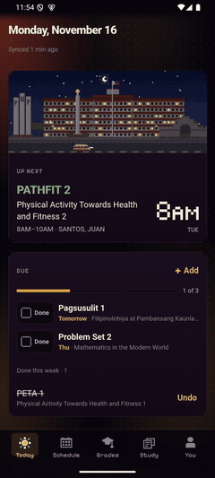
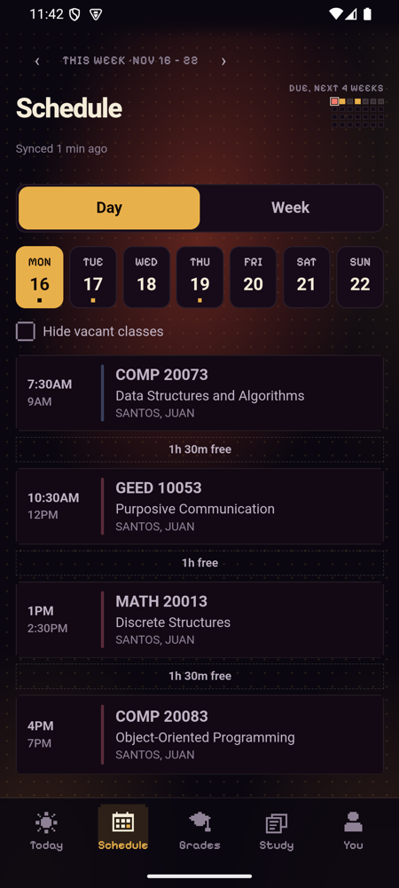

  

  
  
  
  

# IntPortal

A student app for PUP that keeps your classes, grades and deadlines on your phone. It signs in with your own SIS and eMabini accounts, works offline, and keeps everything on the phone. A small robot named LAR shows you around.

IntPortal is unofficial. It is not made by or affiliated with PUP, and it only works with your own account.

  
  
  

## What you get

- **Today.** The class in session, what is due, your classes with the free time between them, and one nudge from LAR.
- **Schedule.** Day and week views. Mark a class vacant or online, move it, colour it, add a note.
- **Grades.** Every term, your GPA, a trend, and what you need on the rest to hit a target.
- **Deadlines.** SIS, eMabini and your own, with Done and Undo. Scan a handout to add one.
- **Study.** Flashcard decks that bring each card back at the right time.
- **Notes.** Per class or per day, with checklists and photos.
- **LAR, optional.** A small assistant that runs on the phone and answers questions about your classes and notes. You download it only if you choose to.
- **Outside the app.** Reminders, a countdown to your next class on the Lock Screen and Dynamic Island (a status-bar chip on Android), and a home-screen widget.

Every feature is listed in [docs/FEATURES.md](docs/FEATURES.md).

  
  
  
  

## Get it

**Android.** Open the [latest release](https://github.com/cGradying/intportal-app/releases/latest), download `IntPortal-<version>.apk`, open it, and allow the install when Android asks. It needs Android 7 or newer on a 64-bit phone. Updates install over the old version and keep your data.

**iPhone.** There is no App Store build yet. You can build it yourself with Xcode: see [docs/BUILDING.md](docs/BUILDING.md).

**Look around first.** Tap it on the sign-in page to try the whole app on sample data, with no PUP account.

## Your data

Everything stays on your phone. There is no IntPortal account, server, analytics or ads. Your login is kept in the phone's keychain, and the app talks only to PUP's own sites. Details are in [PRIVACY.md](PRIVACY.md).

## Built with

Rust for the logic (`crates/`), Svelte 5 for the screens (`src/`), and Tauri 2 to put them on iOS and Android (`src-tauri/`). How the pieces fit is in [docs/ARCHITECTURE.md](docs/ARCHITECTURE.md).

## More

- [Building and running it](docs/BUILDING.md)
- [Architecture](docs/ARCHITECTURE.md) and [terms used in the app](CONTEXT.md)
- [Specs](docs/specs/README.md), [decisions](docs/adr/), [changelog](CHANGELOG.md)
- Found a problem? [Open an issue](https://github.com/cGradying/intportal-app/issues).

## License

[PolyForm Noncommercial 1.0.0](LICENSE): free to read, run and change for noncommercial use. IntPortal is an independent student project.
