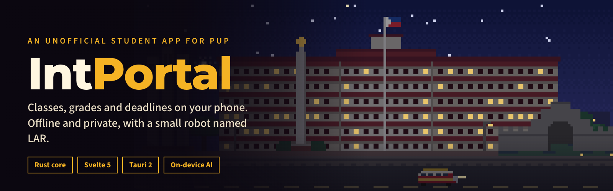
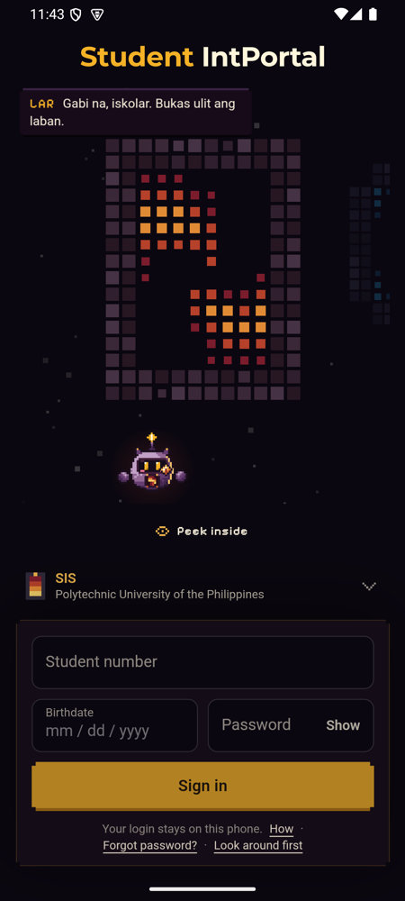
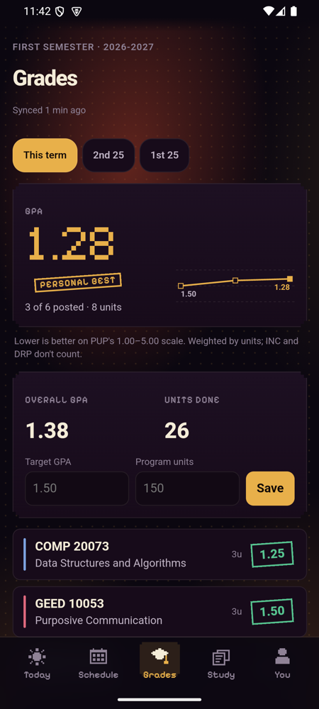
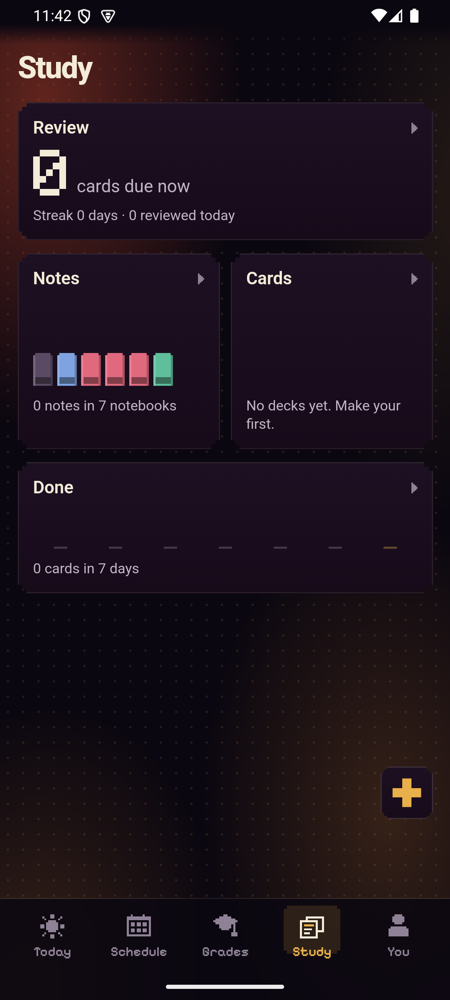
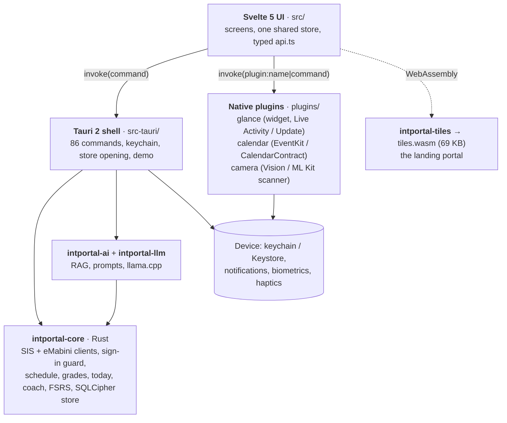
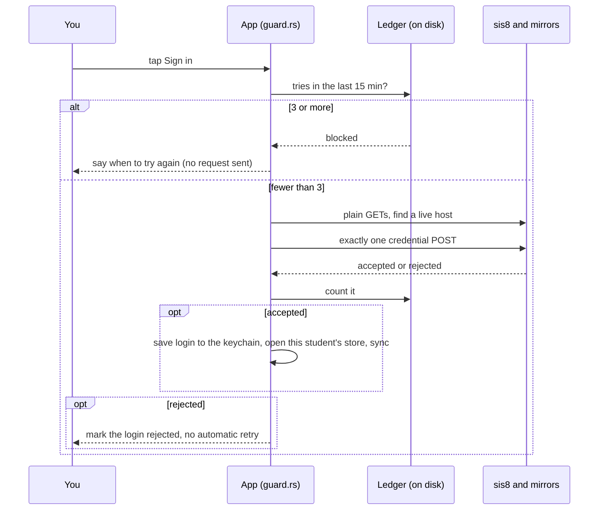
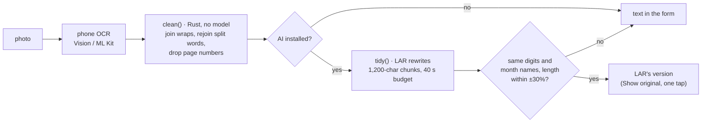
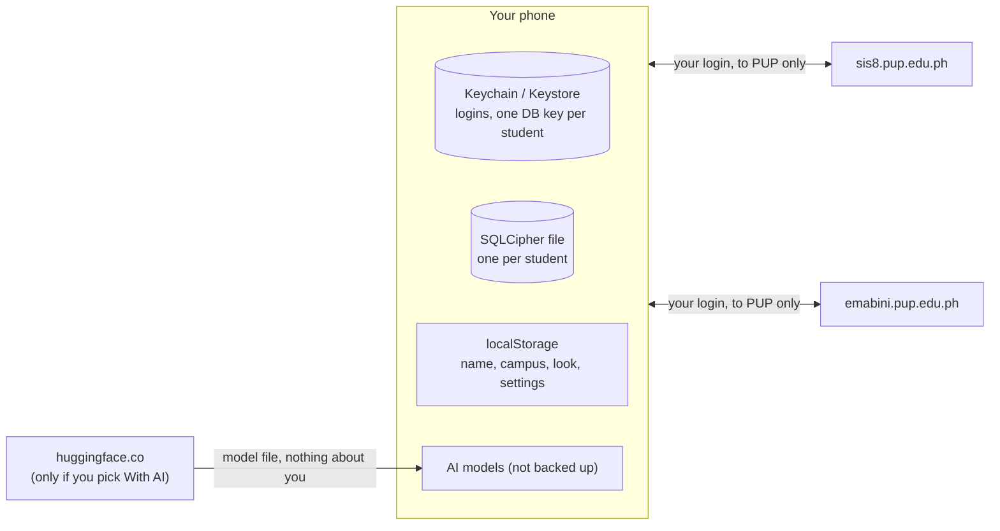

<p align="center">
  
</p>

<p align="center">
  <a href="CHANGELOG.md"></a>
  <a href="https://github.com/cGradying/intportal-app/actions/workflows/ci.yml"></a>
  <a href="https://github.com/cGradying/intportal-app/actions/workflows/ios.yml"></a>
  <a href="https://github.com/cGradying/intportal-app/actions/workflows/android.yml"></a>
  
  
  
  
  <a href="LICENSE"></a>
</p>

<h3 align="center">PUP's SIS and eMabini on your phone. Offline, private, and with a small robot.</h3>

<p align="center">
  
  
  
  
</p>
<p align="center"><sub>The welcome dive, Done, the tabs, and a campus for every hand-drawn PUP site. Recorded from the real app on an Android emulator and from the renderer the app ships.</sub></p>

IntPortal is an unofficial student app for the Polytechnic University of the Philippines. It signs in to PUP's systems with your own account (the SIS for classes and grades, eMabini for courses and deadlines), keeps what it reads on the phone, and adds study tools and an on-device assistant around it. The look is a calm interface on a night ground with crafted pixel-art moments. **LAR**, the Lakbay-Aral Robot, does the talking.

> *"Uy! Ako si LAR, galing sa kabilang side ng portal."* LAR, the first thing a new student reads.

It is a from-scratch rebuild of the macOS app, [cGradying/IntPortal](https://github.com/cGradying/IntPortal), which is now in maintenance. The old app's docs live in `docs/legacy/`; [docs/specs/](docs/specs/README.md) tracks what moves over.

IntPortal is not made by or affiliated with PUP. Only your own account is supported, on the SIS and on eMabini, which is what PUP's terms allow. There are no store releases yet: Android builds are on the [releases page](https://github.com/cGradying/intportal-app/releases) ([install guide](#get-it-on-android)), and for iOS you build it yourself ([steps](#your-own-iphone)). What the app does with your data is in [PRIVACY.md](PRIVACY.md).

**Jump to:** [Get it](#get-it-on-android) · [What it does](#what-it-does) · [Under the hood](#under-the-hood) · [Numbers](#the-numbers) · [War stories](#war-stories) · [Run it](#requirements) · [Contribute](#contributing)

## Get it on Android

1. On your Android phone, open the [latest release](https://github.com/cGradying/intportal-app/releases/latest) and download `IntPortal-<version>.apk`.
2. Open the file. Android asks to allow installs from your browser or Files app: allow it for that app only.
3. Install, then open IntPortal. LAR says hi, and you sign in with your own SIS account.

It needs Android 7 or newer on a 64-bit phone. Updates install over the old version and keep your data. To check the file, compare its SHA-256 with the one in the release notes. The text scanner downloads through Google Play services the first time you use it; on a phone without Play services, type or paste instead.

## What it does

<table>
<tr>
<td width="50%" valign="top">

**Meet LAR.** A new student first talks with LAR: your name, your campus, what you need most. The app is shown inside the chat (a class countdown you scrub, a deadline you tick, a card you flip, a "No signal" switch), then a look and reminders. The portal opens for sign-in after. **Look around first** opens the whole app on sample data, with no PUP account.

**Today.** Your campus drawn at the real hour as the *In session* card, then Due (SIS, eMabini and your own deadlines, with Done and Undo), your classes and the free time between them, LAR's one nudge and your GPA.

**Schedule.** Day and week views. Long-press a class to mark it vacant or online, move it for a week, colour it, or note it.

**Grades.** Every term with a real GPA, a trend, goals, and what you need on the rest to reach a target.

</td>
<td width="50%" valign="top">

**Study.** Flashcard decks scheduled by FSRS. Each rating shows when the card comes back; a round ends with your score and every card's next review.

**Syllabus and notes.** Paste a course outline to track quizzes and exams. Notes are Markdown with templates, checklists and photos, per class or per day. Scan a handout: it is tidied on the phone, and by LAR when the AI is on.

**IntAssis (optional).** LAR answers questions about your classes, grades, deadlines and notes with a small model that runs on the phone, and says which notes an answer came from. Nothing it suggests changes until you confirm.

**Outside the app.** A Live Activity for the next class on Dynamic Island iPhones, a Live Update in the status bar on Android, and a home-screen widget. You choose whether the card always shows, shows only after you leave the app, or never.

</td>
</tr>
</table>

Also: reminders (before class, the evening before deadlines, study days), a calendar of your classes in the phone's own calendar, a Face ID or fingerprint lock, backups you share yourself, and a sign-in guard that cannot get your PUP account locked. Every feature, tab by tab, is in [docs/FEATURES.md](docs/FEATURES.md); what changed in each version is in [CHANGELOG.md](CHANGELOG.md).

<p>
  
  
  
  
  
  
</p>

## Under the hood

Four layers; each only calls the one below it. The core has no UI and no platform APIs, so every rule runs under `cargo test` on any machine.



| Layer | Where | Does |
|---|---|---|
| **Core** (about 7.9k lines of Rust, 218 tests) | `crates/intportal-core` | The portal registry, SIS and eMabini clients and parsers, the sign-in guard, schedule and grade logic, the coach, FSRS, syllabus parsing, calendar events, the encrypted store. |
| **AI** (5.9k + 1.7k lines, 222 tests) | `crates/intportal-ai`, `crates/intportal-llm` | Intents, prompts, JSON schemas, RAG over notes, card and outline generation (`-ai`, tested with a fake model); llama.cpp through `llama-cpp-2`, the model download and the memory gate (`-llm`). See [docs/ai.md](docs/ai.md). |
| **Tiles** (2.0k lines, 43 tests) | `crates/intportal-tiles` | The landing's pixel portal as a pure scene plus plain WebAssembly exports, built by `scripts/tiles.sh` ([ADR 0004](docs/adr/0004-landing-renders-in-rust-wasm-tiles.md)). |
| **Shell** (2.4k lines) | `src-tauri` | Tauri 2 commands, one file per area, the keychain, the per-student store, the demo student. |
| **Interface** (9.7k lines TypeScript, 19.5k Svelte, 507 tests) | `src` | Screens, the one shared `app` store, the motion vocabulary, the campus renderer. |

### Signing in without ever locking you out

PUP's SIS can lock an account after a few bad tries, so every sign-in goes through one guard:



The ledger is a file outside any student's store, so a restart doesn't reset the count. A Mabini failure never fails an SIS sync, and the reverse.

### One scan, three safety nets



A model's rewrite is accepted only if it keeps every digit and month name, so a tidy-up can never change a date or a code.

### The In session scene is a shader

<p align="center"></p>

Each frame is a 192 by 80 fragment shader (WebGL2, falling back to WebGL1, then Canvas2D) with Bayer dithering, upscaled with nearest-neighbour so every pixel stays square. The sky, the stars, the lit windows and the jeepney come from the clock; each campus adds a landmark layer as compact pixel-rect data. Nine campuses are hand-drawn from public photos (recorded in [`campus-looks.md`](docs/specs/reference/campus-looks.md)), the other branches share one scene tinted for the campus, and other schools in the hub get a tinted generic one. Each scene is its own chunk loaded by dynamic `import()`, so a student downloads only theirs. `scripts/campus-sheet.mjs --perf` times the compile and first frame under a 4x CPU throttle.

### Motion has one vocabulary

`src/lib/motion.ts` is the only place animation is defined: transitions (`shared`, `sheet`, `scrim`, `overlay`, `rise`, `leave`, `flow`), `dismiss` for sheets (a drag from the grip bar only), `rubber` for pull-to-sync, and `reduced()` for Reduce Motion, which every animation honours. Durations and easings are tokens in `app.css`; `scripts/style-lint.mjs` fails CI on a hard-coded one. Pressed looks use `[data-press]`, set by `watchPress`, instead of `:active`, so a button can no longer stay stuck on iOS.

### Where your data lives



No IntPortal server, no analytics, no ads ([ADR 0002](docs/adr/0002-device-only-data.md), [PRIVACY.md](PRIVACY.md)). The store keeps its last snapshot in memory, so a read costs no query, and a save writes only the parts that changed in one transaction. A store the key can't open is renamed `.locked-<time>` and a fresh one starts, so the app never bricks and never deletes.

## The numbers

| | |
|---|---|
| Android APK (release, arm64) | **22.3 MB** (was 69.7 MB before 0.2.1); Play bundle 13.2 MB |
| iPhone release | 18 MB installed, 7.7 MB download |
| Landing portal | 69 KB of WebAssembly |
| AI (optional) | 1.42 GB, once: Qwen3 1.7B chat (1.11 GB) + note search (310 MB); runs offline |
| Tests | 507 vitest + 218 core + 222 AI + 43 tiles, about 990 |
| Guard rails in CI | `commands-check` (86 commands registered and invoked, and every plugin permission named in a capability), `style-lint` (type, duration and radius tokens), `tap-targets` (every button 44 pt) |
| Specs | 15 numbered specs with criteria in [docs/specs/](docs/specs/README.md), 5 ADRs in [docs/adr/](docs/adr/) |

How the APK got small: LTO that actually runs, `opt-level = "s"` (3 only for SQLite and llama.cpp), arm64 only, the ML Kit scanner left to Google Play services, resource shrinking, and school art loaded on demand.

## War stories

<details>
<summary><b>The haptics that never buzzed</b></summary>

0.2.0 shipped with no vibration on the phone. The capability file granted `haptics:default`, but that plugin's `default_permission` is `null`, so Tauri's ACL refused every call, and the wrapper swallowed the error. The fix names four permissions; the lesson is now a CI lint: `commands-check` fails when a capability names `<plugin>:default` for a plugin whose manifest has no default. The wrapper also warns once in dev.
</details>

<details>
<summary><b>The crate type that turned LTO off</b></summary>

The release profile asked for link-time optimisation, but `src-tauri` also built an `rlib`, and Cargo silently skips LTO for any crate that does. Building only `staticlib` and `cdylib` let LTO run. With arm64-only and the scanner moved to Google Play services, that took the Android APK from 69.7 MB to 22.3 MB.
</details>

<details>
<summary><b>A stale WebAssembly file drew yesterday's dots</b></summary>

Worktrees share one Cargo build directory, so `scripts/tiles.sh` can copy another branch's `tiles.wasm`. After the landing lost its dot halo, the old halo still showed. The check is `strings static/tiles.wasm | grep ground_grid`, and touching `lib.rs` forces a rebuild.
</details>

<details>
<summary><b>"Nothing due" while the Due card listed three things</b></summary>

LAR said "Nothing due" while the Due card listed a deadline, because the claim didn't check where the data came from. Now `knowsNothingDue` in `deadlines.ts` allows it only when at least one source is connected and every connected source synced in the last day (spec 040 C3), and it is unit-tested.
</details>

## Requirements

- macOS with Xcode and the iOS simulator runtime that matches it (`xcodebuild -downloadPlatform iOS`)
- Rust (stable) with the iOS and WebAssembly targets: `rustup target add aarch64-apple-ios aarch64-apple-ios-sim wasm32-unknown-unknown`
- Node 22 and pnpm
- XcodeGen (`brew install xcodegen`)
- For Android: Android Studio with SDK 36, NDK r28 or newer and an emulator, JDK 17 (`brew install openjdk@17`), and `rustup target add aarch64-linux-android`

Then install the JavaScript dependencies:

```bash
pnpm install
```

## Run it

### Checks

```bash
pnpm check
pnpm test
cargo test -p intportal-core
node scripts/commands-check.mjs
node scripts/style-lint.mjs
node scripts/tap-targets.mjs
```

CI runs the same on every pull request, plus clippy. `commands-check` keeps the commands the shell registers and the ones the interface calls in step; `style-lint` holds type sizes, durations and corners to the tokens in `DESIGN.md`; `tap-targets` holds every button to 44 pt. Each push to `main` also builds the iOS simulator app, and each `android-v*` tag builds the Android release APK.

### iOS simulator

```bash
scripts/sim.sh "iPhone 17 Pro Max"
```

The argument is a simulator name or id; with none, the booted simulator is used. The script builds the debug app, installs it and launches it. Tap **Look around first** to skip sign-in, then **Step through**.

`pnpm tauri ios dev` can pick a real device with the same model name, which then needs signing, so prefer `scripts/sim.sh`.

### Your own iPhone

1. Sign in to Xcode with your Apple ID: Xcode → Settings → Accounts.
2. Unlock the phone, then run:

   ```bash
   APPLE_DEVELOPMENT_TEAM=<your team id> scripts/phone.sh
   ```

   `DEVICE=<name or id>` picks the phone. The script regenerates the Xcode project with your team, builds, installs over USB or Wi-Fi, and restores the committed project files.
3. The first time, trust the developer profile: Settings → General → VPN & Device Management.

A free Apple account works, with two limits. The app stops opening after 7 days, so run the script again to renew it. App Groups aren't available, so the home-screen widget can't show the next class; the Live Activity still works. With a paid account, add `--app-group`.

### Android emulator

```bash
scripts/emu.sh
```

With an emulator running (or a phone on USB), the script builds the arm64 debug APK, installs it and launches it. Tap **Look around first**, then **Step through**. Where each Android piece lives, what to check after a change and the problems already solved are in [docs/android.md](docs/android.md).

### Changing native settings

`src-tauri/gen/apple/project.yml` owns the Info.plist keys, entitlements and deployment target. After editing it, regenerate the project:

```bash
cd src-tauri/gen/apple && xcodegen generate
```

## Keep it small

Rust, Xcode and Gradle builds grow fast; this project once reached hundreds of GB of caches.

- All crates share one Cargo workspace: one `target/` and one `Cargo.lock` at the root. Don't add a crate outside `[workspace] members`.
- Every worktree shares one Cargo build cache in `~/.cargo/build/intportal` (`.cargo/config.toml`), so a new worktree doesn't compile the dependencies again. Each keeps its own `target/` for the final app.
- Dev builds keep line tables only (`[profile.dev]` in the root `Cargo.toml`). Never set `debug = false` for dependencies, because the iOS link then fails.
- `scripts/disk.sh` prints what the builds use. `scripts/clean.sh` deletes this repo's `target/`, the shared build cache, the Xcode and Gradle build folders and this project's DerivedData, and nothing else.
- Never commit build output. Stage paths by name, not `git add -A`.

## Contributing

Work is split by role; `docs/TEAM.md` has the roles, the loop and the review checklist. Each change is its own issue, branch and pull request. Write the failing test first where a cheap test exists, then the change. Check UI changes on the iOS simulator, and on the Android emulator when they touch Android. Use the terms in `CONTEXT.md`. Record a hard-to-reverse decision as an ADR in `docs/adr/`.

## License

[PolyForm Noncommercial 1.0.0](LICENSE): free to read, run and change for noncommercial use. IntPortal is an independent student project and is not affiliated with Polytechnic University of the Philippines.
