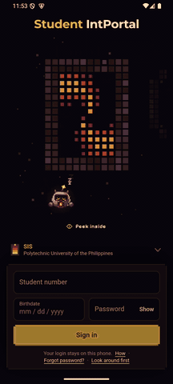
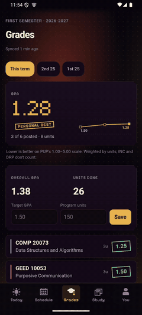
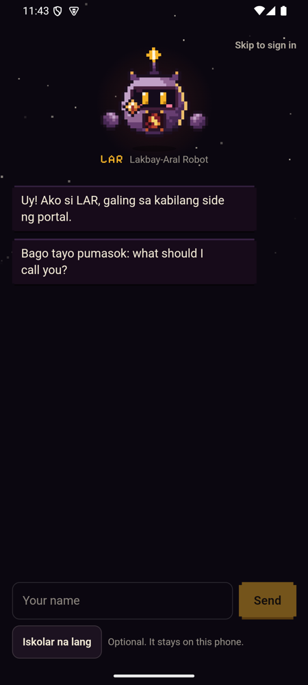
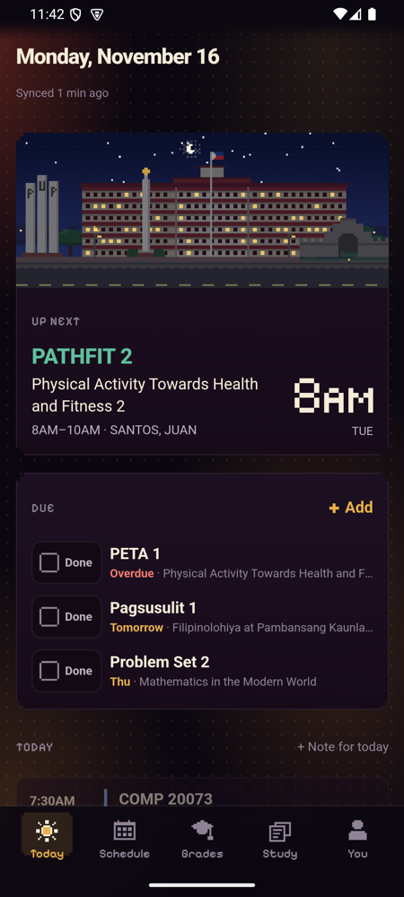
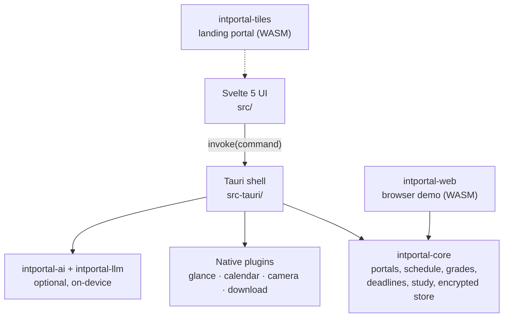

<p align="center">
  
</p>

<h1 align="center">IntPortal</h1>

<p align="center">
  Your classes, grades and deadlines on your phone. Offline, private, and quick.
</p>

<p align="center">
  <a href="https://github.com/cGradying/IntPortal/releases/latest"></a>
  <a href="https://github.com/cGradying/IntPortal/actions/workflows/ci.yml"></a>
  
  <a href="LICENSE"></a>
</p>

<p align="center">
  <a href="https://intportal.pages.dev"><b>Website</b></a> ·
  <a href="https://intportal.pages.dev/download">Download</a> ·
  <a href="https://intportal.pages.dev/app/">Try it in the browser</a> ·
  <a href="CHANGELOG.md">Changelog</a> ·
  <a href="https://github.com/cGradying/IntPortal/issues">Report a problem</a>
</p>

---

School portals are slow, and they don't load where campus has no signal. IntPortal signs in to your school's portal with your own account once, saves what it finds on your phone, and works from there offline. It signs in to PUP's SIS and eMabini today. A school with no portal in the app can still use it: add your classes by hand or scan a photo of your schedule.

A small robot named **LAR** (the Lakbay-Aral Robot) shows you around. You are **Isko**, the student.

<p align="center">
  
  
  
</p>

## Features

| | |
|---|---|
| **Today** | The class in session, what's due, your classes with the free time between them, and one nudge from LAR. |
| **Schedule** | Day and week views, and a four-week month of deadlines. Mark a class vacant or online, move it, colour it, add a note. |
| **Own schedule** | No portal? Add classes by hand, or scan a photo or pasted timetable and check each class before it's saved. |
| **Grades** | Every term, your GPA, a trend, and what you need on the rest to hit a target. |
| **Deadlines** | SIS, eMabini and your own in one list, with Done and Undo. Scan a handout to add one. |
| **Study** | Flashcard decks that bring each card back when you're about to forget it. |
| **Notes** | Per class or per day, with checklists and photos. |
| **IntAssis** *(optional)* | An AI that runs on your phone. It answers questions about your classes and notes and makes flashcards. Nothing is uploaded, and you download it only if you want it. |
| **Outside the app** | Reminders, a countdown to your next class on the Lock Screen and Dynamic Island (a status-bar chip on Android), a home-screen widget, and your classes in the phone's calendar. |

Every feature is listed in [docs/FEATURES.md](docs/FEATURES.md).

<p align="center">
  
  
  
  
</p>

## Install

The [website](https://intportal.pages.dev/download) picks the right file for your device. Every file is also on the [latest release](https://github.com/cGradying/IntPortal/releases/latest).

| Device | File | Notes |
|---|---|---|
| Android 7+ (64-bit) | `IntPortal.apk` | Open it and allow the install. Updates keep your data. |
| iPhone | `IntPortal-unsigned.ipa` | No App Store build yet. Sideload with AltStore or SideStore. |
| Mac (Apple Silicon) | `IntPortal-mac.dmg` | Unsigned, so the first launch asks once. |
| Windows | `IntPortal-windows.msi` | Unsigned, so Windows asks once. |
| Linux | `IntPortal-linux.AppImage` or `.deb` | |

To try it first, tap **Look around first** on the sign-in page, or open the [browser demo](https://intportal.pages.dev/app/). Both run the whole app on sample data, with no school account.

## Privacy

- Everything stays on your phone. There is no IntPortal account, server, analytics or ads.
- Your login is kept in the phone's keychain. Your data is in an encrypted database with its own key.
- The app talks only to your school's own sites, and to the model download if you choose IntAssis.
- Sign-ins go through a guard. It allows at most three tries per 15 minutes and never retries a rejected password, so the app can't get your account locked.

Details are in [PRIVACY.md](PRIVACY.md).

## How it's built

Rust holds the logic, Svelte 5 draws the screens, and Tauri 2 ships them to phones and computers. The same Rust core compiles to WebAssembly for the browser demo.



| Path | What's there |
|---|---|
| `crates/` | The Rust core, the AI, the landing portal and the browser build |
| `src-tauri/` | Commands, keychain, store opening, and the iOS and Android projects |
| `src/` | The app's screens |
| `plugins/` | Native code for the widget and Live Activity, calendar, camera and model downloads |
| `site/` | The website at [intportal.pages.dev](https://intportal.pages.dev) |
| `reel/` | The intro video, rendered from code |

How the pieces fit and what must stay true is in [docs/ARCHITECTURE.md](docs/ARCHITECTURE.md).

## Development

Building from this source needs the copyright holder's permission (see [LICENSE](LICENSE)). The maintainer's notes are in [docs/BUILDING.md](docs/BUILDING.md) (simulator, emulator and phone builds) and [docs/RELEASING.md](docs/RELEASING.md).

Every pull request runs these checks in CI, plus clippy:

```bash
pnpm check && pnpm test
cargo test -p intportal-core
node scripts/commands-check.mjs
node scripts/style-lint.mjs
```

## Docs

- [Architecture](docs/ARCHITECTURE.md) and the [terms used in the app](CONTEXT.md)
- [Features](docs/FEATURES.md), [specs](docs/specs/README.md) and [decisions](docs/adr/)
- [On-device AI](docs/ai.md) and [Android notes](docs/android.md)
- [The website](site/README.md) and [the reel](reel/README.md)
- [Changelog](CHANGELOG.md)

## License

All rights reserved ([LICENSE](LICENSE)). The code is published so you can read it. Using, copying or changing it needs permission. The official builds are free to download and use on your own devices. Versions 0.5.0 and earlier were published under PolyForm Noncommercial 1.0.0, which still covers copies taken then.

IntPortal is a personal project by a PUP student. It is not made by or affiliated with any school, and it only works with your own account.
