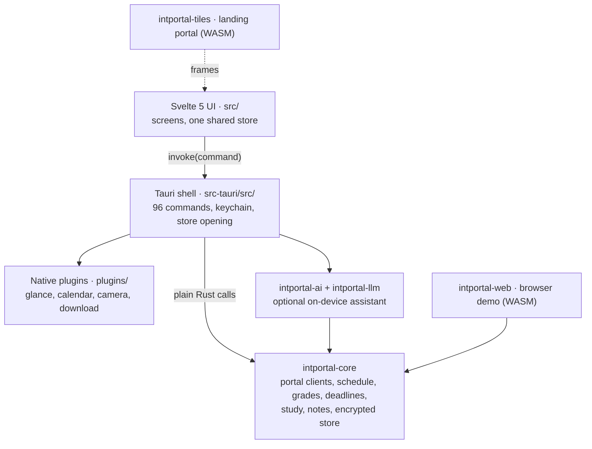

# Architecture

How IntPortal is put together and what must stay true. Read it with [CONTEXT.md](../CONTEXT.md), which explains the app's terms.

## Layers

Each layer only calls the one below it. The core has no UI and no platform code, so all of its logic is tested with `cargo test` on any machine. The shell is thin: it turns commands into core calls and owns the few things that need the phone. The UI holds no domain rules; it asks the core and draws the answer.

## Crates

| Crate | What it is | Tested by |
|---|---|---|
| `intportal-core` | All of the app's logic and the encrypted store. No UI, no platform code. | `cargo test` on any machine |
| `intportal-ai` | The assistant's logic that needs no model: prompts, schemas, reply parsing, search over notes. | `cargo test` with a fake model |
| `intportal-llm` | llama.cpp behind the `Llm` trait, and the model download. Linux gets a stub. | By hand on a Mac (CI never compiles llama.cpp) |
| `intportal-tiles` | The landing's tile portal, compiled to WebAssembly by `scripts/tiles.sh`. | `cargo test` |
| `intportal-web` | The browser demo. It answers each `invoke` from an in-memory demo account with the same core functions the shell uses. Commands that need the phone return "That works in the app". | `cargo test`, plus a wasm build in CI |

`spikes/` holds two throwaway experiments (`s0-sis-http`, `s1-llama`). CI still tests `s0-sis-http`.

## The core, module by module

| Module | What it does |
|---|---|
| `portal.rs` | The portal registry: each PUP system the app opens (SIS, Mabini, and placeholders), with its status, theme, sign-in fields, limits and keychain service. |
| `sis/` | The SIS client (`client.rs`), the live-host probe (`host.rs`), HTML scraping (`scrape.rs`), and the sign-in guard (`guard.rs`): one credential POST per tap, a `Ledger` of tries per 15 minutes, no retry after a rejected login. |
| `mabini/` | The eMabini (Moodle) client: login with its `logintoken`, the `sesskey`, the AJAX calls for courses and deadlines, and the grade overview table (`parse.rs`). |
| `schedule.rs` | Turns scraped schedule rows into `ClassSession`s. |
| `grades.rs` | Grade parsing, GPA, goals and `Standing` (what you need on the rest). |
| `today.rs` | The agenda for a moment: up next, free time, marks and moves, busy spans, reminders, the glance line. The largest module. |
| `coach.rs` | Picks LAR's one nudge from signals. |
| `study.rs` | Decks, cards and FSRS scheduling, answer checks, distractors, the streak. |
| `syllabus.rs` | Parses a pasted course outline into items, and the grade tally. |
| `notes.rs` | Notes per class or per day, and their Markdown export. |
| `calendar.rs` | `.ics` export and the class events written to the phone's calendar. |
| `deadline.rs` | Every deadline in one list: syllabus items, eMabini work and the student's own. Today, reminders, LAR and the calendar all read it. |
| `when.rs` | Reads a day and a class out of the student's own words ("quiz COMP fri"). Rules only; the model never computes dates. |
| `own_class.rs` | Classes the student adds by hand. On the week they are plain sessions with `own` set, so every screen reads them like synced ones. |
| `timetable.rs` | Turns a photo or paste of a schedule into own classes for the student to check. |
| `scan.rs` | Cleans the phone's OCR text: line wraps, split words, page furniture. It never changes a word, number, code or date. |
| `nudge.rs` | One daily budget for everything the phone says besides class reminders, and nothing at night. |
| `backup.rs` | The backup file: what the student made, as JSON. No logins, tokens or SIS data. |
| `campus.rs` | Resolves a student number to one of PUP's campuses. |
| `schools.rs` | The other state universities in the portal hub, one row each, before their portals are built. |
| `demo.rs` | The made-up week, term and eMabini behind **Look around first** and the browser demo. |
| `model.rs` | Shared types: `ClassSession`, `Weekday`. |
| `store.rs` | The SQLCipher store, one file per student. `Snapshot` holds the SIS data, marks, colours, goals and plans. Notes, decks and study stats have their own tables, Mabini's data is saved apart from the `Snapshot` (`save_mabini`), and the AI keeps its chat (`turns`) and search index (`chunks`) here too. |

## The shell

`src-tauri/src/lib.rs` holds the app state (the open store, the signed-in SIS and Mabini clients, one sign-in guard per portal) and registers all 96 commands. Commands live in `src-tauri/src/commands/`, one file per area (account, classes, schedule, deadlines, notes, study, coach, mabini, backup). Beside them:

| File | What it owns |
|---|---|
| `keychain.rs` | The platform keychain: Keychain Services on Apple, Keystore-sealed values on Android, Credential Manager on Windows, Secret Service on Linux. |
| `vault.rs`, `mabini_vault.rs` | The SIS and eMabini logins, each in its own keychain entry. |
| `dbkey.rs` | One random 32-byte key per store file, made on its first open. |
| `demo.rs` | The sample student behind **Look around first**. |
| `ai.rs` | The assistant's commands. None of them writes; they return a proposal the UI confirms. | A store its key can't open is renamed `.locked-<time>` and a fresh one starts, so the app never bricks and never deletes.

## The interface

- `src/routes/+page.svelte` boots the app and shows the landing or the five tabs.
- `src/lib/state.svelte.ts` is the one shared store. Screens read it; only this file writes it.
- `src/lib/api.ts` wraps each command in a typed function. `scripts/commands-check.mjs` fails CI when the commands and these wrappers drift apart.
- `src/lib/screens/` holds Today, Schedule, Grades, Study and You.
- A new student first meets LAR in `src/lib/welcome/Talk.svelte`, then the landing's portal (`Landing.svelte`).
- The In session picture is a small shader scene per campus (`src/lib/campus/scenes/`): Sta. Mesa and the Metro Manila campuses each have their own, other branches share one, and other schools get a scene tinted by their colour. Each scene is its own chunk, loaded only for the student's campus.
- LAR's chat and the assistant's screens are in `src/lib/assis/`.
- All motion comes from one set of helpers and timings in `src/lib/motion.ts`, and Reduce Motion is honoured everywhere.

## Main flows

- **Sign in.** The shell sends one login request per tap through a guard: at most three tries per 15 minutes per portal, and no automatic retry after a rejected password, so the app can't get a PUP account locked. A good login is saved to the keychain, the student's store opens, and the schedule and grades load.
- **Sync.** `syncNow()` signs in again from the saved login if the session expired, through the same guard. A failed grades page keeps the last grades.
- **Every minute.** `refreshToday()` rebuilds Today, then sends the next class to the widget and the class card on the Lock Screen (iOS Live Activity, Android Live Update). The student chooses in You › Reminders whether the card always shows, shows only after leaving the app, or never.
- **Reminders.** Notifications are replaced with the next week's on each launch and sync.
- **Own schedule.** A student whose school has no portal picks Own schedule and starts with no login. Classes come from the class editor or from a scanned timetable (`timetable.rs`), and every class found is shown to check before it's saved. A sync never removes an own class.
- **Scan.** A photo's text is read by the phone's recognizer and cleaned in Rust. With the assistant installed, LAR also tidies it, and his version is kept only if every number, code and date is unchanged.

## The optional assistant

LAR's chat runs a small model with llama.cpp, on the phone, only after the student chooses to download one ([ADR 0003](adr/0003-on-device-ai-llama-cpp.md)). `intportal-ai` is pure Rust (prompts, schemas, search over notes) and is tested with a fake model. `intportal-llm` runs the real model and downloads it. The assistant never changes anything itself: it shows a confirm card, and tapping Apply calls the normal commands. More in [ai.md](ai.md).

## Invariants

- **Data stays on the phone.** No backend and no sync between devices until the cloud tier ([ADR 0002](adr/0002-device-only-data.md)).
- **Only the student's own account.** That is what PUP's terms allow.
- **Logins are in the keychain**, one service per portal, never in the store, logs or localStorage.
- **No portal can get a student locked out.** Every sign-in goes through the guard: one POST per tap, at most three tries per 15 minutes per portal, no automatic retry after a rejection.
- **Own classes are the student's.** A sync never removes or changes them.
- **Portals don't share state.** A Mabini failure never fails an SIS sync, and the reverse.
- **Each student's store is SQLCipher-encrypted** with its own key in the keychain. A store that won't open is set aside, never deleted.
- **The core stays pure.** No platform APIs in `intportal-core`; anything that needs the phone goes in the shell or a plugin.
- **LAR speaks.** He is the only character. Copy follows `PRODUCT.md` and `DESIGN.md`.
- **Reduce Motion is honoured** everywhere, including the landing.
- **Anything that opens over the page registers its close with `closable()`**, so Android's back gesture closes it and not the app.

## iOS and Android

Both run the same Rust and the same Svelte. They differ only in the shell and the plugins:

| | iOS | Android |
|---|---|---|
| Keychain | Keychain Services (`keyring`) | Keystore-sealed values (`Secrets.kt`) |
| Store encryption | SQLCipher on CommonCrypto | SQLCipher on vendored OpenSSL |
| Next class outside the app | Live Activity, widget (widget needs a paid team for App Groups) | Live Update in the status bar, widget |
| Scanner | Vision | ML Kit through Google Play services (not bundled, to keep the APK small) |
| Release build | `scripts/phone.sh`, release by default | `scripts/emu.sh --release`: arm64 only, R8 and resource shrinking, signed APK and AAB |
| Calendar | EventKit | CalendarContract |
| Native project | `gen/apple`, generated from `project.yml` | `gen/android`; see `docs/android.md` |

Desktop builds (macOS, Windows, Linux) use the same shell with the platform keychain and no native plugins. `.github/workflows/desktop.yml` builds them for each release.

Desktop `cargo` builds compile neither the Swift nor the Kotlin. Only `scripts/sim.sh` and `scripts/emu.sh` prove them.

## CI

`.github/workflows/ci.yml` runs two jobs on every pull request:

- **web:** `commands-check`, `style-lint`, `pnpm check`, `pnpm test`, `pnpm build`.
- **rust:** `cargo test` and `clippy -D warnings` on core, shell, tiles, web and the SIS spike, then the wasm build of `intportal-web`.

CI never compiles llama.cpp, the Swift or the Kotlin. Changes there are proven on a simulator, an emulator or a phone.

## Size

Small and fast is a requirement. In 0.6.0 the Android APK is 22.6 MB, the iPhone IPA 7.8 MB, and the Mac, Windows and Linux `.deb` builds about 8 MB each. The release profile in the root `Cargo.toml` turns on link-time optimisation and optimises for size, keeping full speed only for SQLite and llama.cpp. `src-tauri` builds only `staticlib` and `cdylib`, because an `rlib` output makes Cargo skip LTO. Android builds for arm64 only, the text scanner comes from Google Play services, and each campus scene and the AI model download only when needed.

## Decisions

- [0001](adr/0001-tauri-rust-svelte.md) Tauri, Rust and Svelte.
- [0002](adr/0002-device-only-data.md) Student data stays on the device.
- [0003](adr/0003-on-device-ai-llama-cpp.md) On-device AI runs llama.cpp in Rust; local only.
- [0004](adr/0004-landing-renders-in-rust-wasm-tiles.md) The landing renders in Rust/WASM tiles.
- [0005](adr/0005-portals-are-first-class.md) Portals are first-class: SIS and Mabini (eMabini) are ready.
- [0006](adr/0006-one-repo.md) One repo for the app, the website and the reel.

## Known gaps

- `src/lib/api.ts` types are written by hand to match the Rust structs, so a changed field isn't caught until runtime (#61).
- The SIS parsers have no fixtures from real pages, so a change on PUP's side shows up only on a phone.
- `You.svelte` is 1,100 lines and the other screens 600 to 750; they could be split (#64).
- `intportal-web` mirrors the shell's command bodies by hand, so a changed command can drift from the demo until its test fails.
- Screens are checked by hand on the simulator and emulator.
